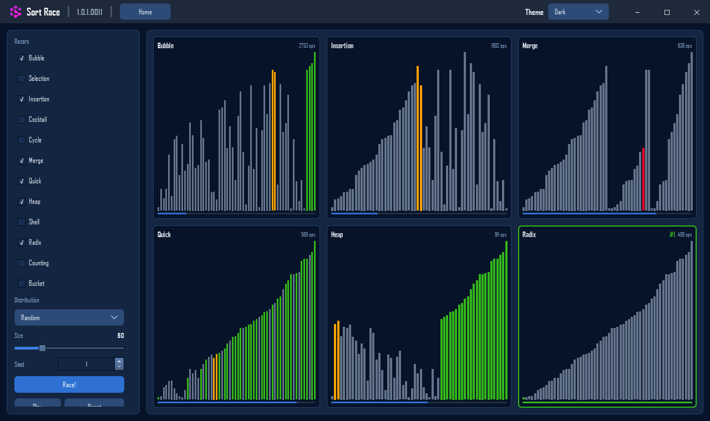

# Sort Algorithm Studio

A learning + research hub for **sorting algorithms**, built with a pure generic C++20
**core** and a **Qt 6 / QML** desktop app. Educate (watch a sort run step by step) and
research (benchmark sorts across input distributions and sizes). Sibling to
[Graph Algorithm Studio](../graph_algo).



Twelve sorts across three complexity categories, each implemented as a C++20 module:

- **O(n²)** — Bubble, Selection, Insertion, Cocktail, Cycle
- **O(n log n)** — Merge, Quick, Heap
- **Advanced** — Shell, Radix (LSD), Counting, and Bucket — non-comparison / distribution


## Workspaces

- **Visualizer** — generate an array (random / sorted / reversed / nearly-sorted /
  few-unique / gaussian) or type/paste your own, pick a sort, and play it forward,
  backward, step, or seek. Three colour-coded views (**bars**, **dots**, **colour
  strip**), a **synced pseudocode** panel that highlights the current line, an
  ascending/**descending** toggle, optional **sound** (pitch per step), and a live
  CPU/GPU/RAM monitor.
- **Analyzer** — a headless benchmark sweep over sizes for one distribution:
  median time, **CPU time**, **peak memory**, comparison/swap/write counts, a
  metric-selectable scaling chart with an optional **Big-O overlay**, and CSV export.
- **Knowledge** — a searchable reference: how each sort works, stability, in-place,
  best/avg/worst complexity, and deep links into the Visualizer / Analyzer.
- **Stability** — see which sorts keep equal keys in their original order: input vs
  result bar strips coloured by original position, with a verdict.

## Build

### Core + tests (no Qt)

```sh
cmake -S . -B build && cmake --build build && ctest --test-dir build
```

The CTest suite is `sa_test_core` (fixed cases + concept checks), `sa_test_gen_bench`
(generators + timing harness), and `sa_test_fuzz` (every sort vs `std::sort` over
hundreds of random inputs). The build also fails if any generated `include/sa/*.hpp`
is stale vs its `.ixx`. [CI](.github/workflows/ci.yml) runs all of this on Linux,
Windows and macOS.

### The app

Needs Qt 6 (6.5+) and the shared [UiKit](../UI_repo) sibling module.

```sh
cmake -S . -B build-app -G Ninja \
  -DCMAKE_PREFIX_PATH=<Qt>/mingw_64 \
  -DSORT_ALGO_BUILD_APP=ON
cmake --build build-app
./build-app/studio/sort_algorithm_studio.exe
```

Override the UiKit location with `-DSA_UI_REPO=<path>` if it isn't at `../UI_repo`.

### C++20 modules (MSVC / Visual Studio 2026)

The `core/modules/**/*.ixx` are the source of truth. Open `core/sort_algo.slnx` to
build them directly. After editing a `.ixx`, regenerate the header twins the Qt build
and tests consume:

```sh
py -I scripts/gen_sa_hpp.py          # regenerate core/include/sa/*.hpp
py -I scripts/gen_sa_hpp.py --check  # CI: fail if any header is stale
```

## Platform

The **core** is portable C++20 and is exercised by CI on Linux, Windows and macOS.
The **app** builds with Qt 6 on any platform, and the sound (`QAudioSink`) is
cross-platform. Two things are Windows-specific today: the live **system monitor**
samples CPU/GPU/RAM via Win32 + PDH (it compiles elsewhere but reads zeros), and the
packaged **installer** uses Inno Setup. Full Linux/macOS monitoring is a future item.

See [ARCHITECTURE.md](ARCHITECTURE.md) for the full design.
